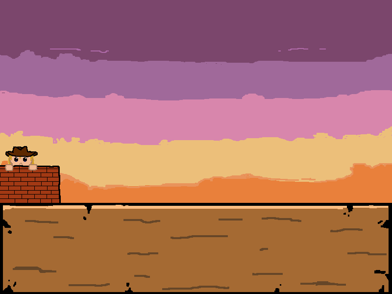

# TYPING CHASE

**Jogo 2D de treino de digitação** feito em **Python + Pygame**: você digita as palavras que aparecem nos inimigos para destruí-los antes que cheguem até você, desviando de obstáculos e acumulando combo e moedas.

> **Status:** protótipo jogável / beta — build de 07/12/2024
> **Autor:** Bruno Brás Barros


<!--
  Adicione aqui um GIF de gameplay quando tiver um:
  
-->

---

## Sobre o projeto

O jogo mistura **ação em runner lateral** com **prática de digitação**. Cada inimigo carrega uma palavra e a letra atual fica destacada; ao digitar a letra correta, o personagem dispara e remove a letra da palavra. A ideia é treinar a **postura das mãos no teclado**: teclas da mão esquerda atiram para a esquerda e teclas da mão direita atiram para a direita, com um **guia visual de dedos** indicando qual dedo usar.

### Funcionalidades

- **3 fases** com identidade própria: `0 - Tutorial`, `1 - Chapter 1` e `2 - Chapter 2` (com cutscene e chefe **ZH4R0V**).
- **10 tipos de inimigos** (`target`, `normal_minibot`, `wild_minibot`, `spike_minibot`, `fake_minibot`, `hivebox`, `mototaxi`, `classB`, `classC`, `classD`) e **3 obstáculos** (`missile`, `barrier`, `tumbleweed`).
- **Dificuldade adaptativa**: a velocidade, o intervalo de spawn e a variedade de inimigos aumentam conforme a distância percorrida.
- **Spawn ponderado**: cada fase define pesos de probabilidade para inimigos e obstáculos.
- **Combo, moedas e desbloqueio de fases**: moedas são ganhas destruindo inimigos e usadas para liberar a próxima fase.
- **Guia visual de teclado e dedos**: destaca a mão e o dedo correspondentes à próxima letra.
- **Tutorial** com recompensa inicial e **cutscene** narrada no Chapter 2.
- **Múltiplos perfis de jogador** com progresso salvo em JSON.
- **Pause, game over e HUD** com distância, vidas, combo e moedas.
- Efeitos visuais de **partículas** e gerenciador de **música e efeitos sonoros**.

---

## Como jogar

### Requisitos

- Python **3.10+** (testado no 3.12)
- [Pygame](https://www.pygame.org/) **2.x**

### Instalação e execução

```bash
# 1. Clone o repositório
git clone https://github.com/Bruno-Bras/Typing-chase.git
cd Typing-chase

# 2. (Opcional) Crie um ambiente virtual
python -m venv .venv
# Windows
.venv\Scripts\activate
# Linux/macOS
source .venv/bin/activate

# 3. Instale a dependência
pip install pygame

# 4. Rode o jogo a partir da raiz do projeto
python .
```

> **Importante:** execute sempre **a partir da raiz do projeto**. Todos os caminhos de assets e textos são relativos ao diretório atual.

---

## Controles

### Menu principal

| Tecla | Ação |
| --- | --- |
| `↑` / `W` | Próxima fase |
| `↓` / `S` | Fase anterior |
| `0` `1` `2` | Selecionar a fase direto |
| `Enter` | Iniciar a fase (ou desbloquear, se tiver moedas) |
| `Esc` | Desselecionar a fase |

### Seleção de jogador

| Tecla | Ação |
| --- | --- |
| Letras, números, `_` e `-` | Digitar o nome (até 13 caracteres) |
| `←` / `→` | Navegar pelas contas existentes |
| `Backspace` | Apagar último caractere |
| `Enter` | Carregar ou criar a conta |

### Durante o jogo

| Tecla | Ação |
| --- | --- |
| Teclas da mão **esquerda** | Atirar para a esquerda |
| Teclas da mão **direita** | Atirar para a direita |
| `Espaço` | Esquivar (dodge) |
| `Esc` | Pausar |

### Pause / Game over

| Tecla | Ação |
| --- | --- |
| `Espaço` / `Enter` | Continuar (no pause) |
| `Espaço` / `Esc` | Voltar ao menu (game over e fim do tutorial) |

---

## Estrutura do projeto

```
typing-chase/
├── __main__.py            # Ponto de entrada (try/except + save ao sair)
├── typing_chase.py        # Classe Game: loop principal e máquina de estados
├── constants.py           # Configurações, sprites, custos, formato de save
├── text_storage.py        # Todos os textos da interface (objetos Text)
├── modules/               # Lógica do jogo
│   ├── levels.py          # Fases, spawn e curva de dificuldade
│   ├── hands.py           # Guia visual das mãos e dedos
│   ├── sprite.py          # Sistema de animação
│   ├── game_object.py     # Classe base de objetos do jogo
│   ├── cutscene.py        # Cutscene do Chapter 2
│   ├── objects/           # Player, inimigos e obstáculos
│   └── terrain/           # Cenário com scrolling
├── interfaces/            # Telas: menu, player_select, pause, game_over...
├── utils/                 # asset_loader, sound, particles, text, colors
├── text_files/            # Banco de palavras (words_2 ... words_8, all_words)
├── assets/                # Sprites, músicas, SFX, fontes e cutscene
└── data_storage/          # Saves em JSON (criado automaticamente)
```

---

## Como funciona

- **Máquina de estados** (`typing_chase.py`): o atributo `state` decide o que é atualizado e desenhado a cada frame — `player_select`, `menu`, `level`, `pause`, `gameover`, `tutorial_end` e `loading`.
- **POO com herança e composição**: `GameObject` concentra posição, colisão e ciclo de vida; `Player`, `EnemyModel` e os obstáculos herdam dele. Cada `Sprite` cuida da própria animação (`oneshot` ou em loop).
- **Carregamento dinâmico de classes**: inimigos e obstáculos são instanciados por nome via `importlib`, a partir de `modules/objects/`.
- **Dificuldade progressiva**: `Level.increase_difficulty()` ajusta velocidade, intervalo de spawn (com variação aleatória), quantidade máxima de inimigos e pesos de cada inimigo conforme a distância.
- **Banco de palavras**: as palavras são carregadas de `text_files/` por tamanho (2 a 8 letras) e o comprimento usado cresce com a dificuldade.
- **Persistência em JSON**: um arquivo por jogador em `data_storage/`. Ao carregar, chaves ausentes são adicionadas automaticamente a partir do template (`DATA_FORMAT`), evitando quebrar saves antigos.

### Formato do save

```json
{
  "name": "player0",
  "cash": 0,
  "max_cash": 0,
  "tutorial_finished": false,
  "level0": { "unlocked": true,  "max_distance": 0, "max_cash": 0, "max_combo": 0 },
  "level1": { "unlocked": false, "max_distance": 0, "max_cash": 0, "max_combo": 0 },
  "level2": { "unlocked": false, "cutscene_finished": false, "max_distance": 0, "max_cash": 0, "max_combo": 0 }
}
```

---

## Tecnologias

- **Python 3** — lógica do jogo, persistência e automação de assets
- **Pygame 2** — renderização 2D, animações, áudio e input
- **JSON** — salvamento de progresso por jogador
- **Git/GitHub** — versionamento

---

## Assets e licenças

Os arquivos de **código** deste repositório foram desenvolvidos pelo autor. Músicas, fonte e parte dos sprites são **assets de terceiros** usados apenas para fins educacionais e de demonstração — verifique as licenças originais antes de reutilizá-los ou redistribuí-los comercialmente.

---

## Autor

**Bruno Brás Barros**
- GitHub: [@Bruno-Bras](https://github.com/Bruno-Bras)
- LinkedIn: [bruno-barros](https://linkedin.com/in/bruno-barros-3591aa277)
- E-mail: bbb.snf24@uea.edu.br

